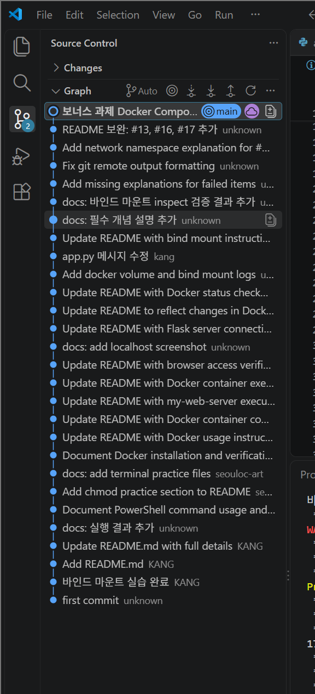

# 내 컴퓨터에 개발용 '작업실' 꾸미기

## 1. 프로젝트 개요 및 실행 환경

Python Flask 기반 웹 서버를 직접 작성하고, 터미널(CLI)·Docker·Git/GitHub을 활용해 어느 환경에서나 동일하게 재현 가능한 로컬 개발 워크스테이션을 구축한 입학연수 미션 기록입니다.

| 항목 | 구성 정보 |
|---|---|
| **OS / Shell** | Windows / PowerShell, Git Bash |
| **Docker** | `29.9.2` (`build a82e528`, Docker Desktop / `desktop-linux`) |
| **Git** | `2.56.0.windows.4` |
| **언어 및 프레임워크** | Python 3.9 (`python:3.9-slim`), Flask |
| **원격 저장소** | `https://github.com/seouloc-art/my-web-server.git` |

### 프로젝트 폴더 구조
- `app.py`: `0.0.0.0:5000` 포트로 동작하는 Flask 웹 서버 메인 코드
- `Dockerfile`: `python:3.9-slim` 베이스 이미지에 Flask 환경을 구성하는 커스텀 이미지 설계도
- `docker-compose.yml`: 포트 포워딩, 바인드 마운트, 환경 변수를 코드로 정의한 Compose 설정 파일
- `images/browser-localhost.png`: `http://localhost:5000` 브라우저 접속 성공 증빙 이미지
- `images/vscode-github.png`: VS Code GitHub 저장소 연동 증빙 이미지
- `README.md`: 전체 수행 로그, 검증 결과 및 트러블슈팅 기술 문서

---

## 2. 수행 항목 체크리스트

- [x] 터미널 기본 조작 및 디렉토리/파일 관리
- [x] 파일 및 디렉토리 권한(`chmod`) 변경 실습 및 전/후 비교
- [x] Docker 설치 및 데몬 동작 점검 (`docker --version`, `docker info`)
- [x] Docker 기본 운영 명령 (`images`, `ps`, `ps -a`, `logs`, `stats`)
- [x] 컨테이너 실행 실습 (`hello-world`, `ubuntu` 진입, `exec` vs `attach` 비교)
- [x] 기존 베이스 이미지 기반 Dockerfile 커스텀 이미지 빌드 및 실행
- [x] 포트 매핑(`5000:5000`) 및 브라우저 접속 확인
- [x] 바인드 마운트 실시간 변경 반영 검증
- [x] Docker 볼륨 생성 및 컨테이너 삭제 후 데이터 영속성 검증
- [x] Git 사용자·기본 브랜치 설정 및 VS Code / GitHub 연동
- [x] (보너스) Docker Compose 작성, 환경 변수 주입 및 운영 명령어 실습

---

## 3. 핵심 개념 정리

- **절대 경로 vs 상대 경로**: 절대 경로는 최상위 루트부터 전체 경로를 명시하는 방식(예: `C:\Users\<사용자명>\Desktop\my-web-server`)이고, 상대 경로는 현재 작업 디렉토리를 기준으로 위치를 지정하는 방식(예: `./app.py`)입니다.
- **파일 권한(`r`/`w`/`x`)과 숫자 표기(`755`, `644`, `700`)**: 읽기(`r`=4), 쓰기(`w`=2), 실행(`x`=1)의 합으로 소유자·그룹·기타 사용자 권한을 표현합니다. `755`는 소유자 읽기/쓰기/실행(7), 그룹·기타 읽기/실행(5)이며, `644`는 소유자 읽기/쓰기(6), 나머지 읽기(4)를 의미합니다.
- **이미지 vs 컨테이너**: 이미지는 실행에 필요한 코드·런타임·라이브러리를 담은 불변의 설계도이며, 컨테이너는 해당 이미지를 격리된 환경에서 실제로 실행한 인스턴스입니다.
- **포트 매핑이 필요한 이유**: 컨테이너는 독립된 네트워크 네임스페이스를 사용하므로 호스트에서 컨테이너 내부 포트(`5000`)에 직접 접근할 수 없습니다. `-p 5000:5000` 옵션으로 `호스트(:5000) → 컨테이너(:5000)` 통로를 연결해야 브라우저 접속이 가능합니다.
- **바인드 마운트 vs Docker 볼륨**:

| 구분 | 바인드 마운트 | Docker 볼륨 |
|---|---|---|
| **저장 위치** | 사용자가 지정한 호스트 폴더 | Docker가 관리하는 독립 영역 |
| **지정 방식** | 경로 직접 입력 (`-v ${PWD}:/app`) | 볼륨 이름 지정 (`-v my-volume:/data`) |
| **주 용도** | 개발 중 로컬 코드 수정 사항의 실시간 반영 | 컨테이너 삭제와 무관한 데이터 영속 보관 |

- **Git vs GitHub**: Git은 로컬 PC에서 파일 변경 이력과 브랜치를 관리하는 분산 버전 관리 도구이며, GitHub은 Git 저장소를 원격 서버에 호스팅해 백업·협업을 지원하는 플랫폼입니다.

---

## 4. 터미널 조작 및 권한 실습

### PowerShell 기본 명령어 수행 로그
```powershell
PS C:\Users\<사용자명>\Desktop\my-web-server> pwd
C:\Users\<사용자명>\Desktop\my-web-server

PS C:\Users\<사용자명>\Desktop\my-web-server> ls -Force
PS C:\Users\<사용자명>\Desktop\my-web-server> mkdir terminal-practice
PS C:\Users\<사용자명>\Desktop\my-web-server> cd terminal-practice

PS C:\Users\<사용자명>\Desktop\my-web-server\terminal-practice> New-Item empty.txt -ItemType File
PS C:\Users\<사용자명>\Desktop\my-web-server\terminal-practice> echo "hello terminal" > hello.txt
PS C:\Users\<사용자명>\Desktop\my-web-server\terminal-practice> cat hello.txt
hello terminal

PS C:\Users\<사용자명>\Desktop\my-web-server\terminal-practice> cp hello.txt copy-hello.txt
PS C:\Users\<사용자명>\Desktop\my-web-server\terminal-practice> mv copy-hello.txt renamed-hello.txt
PS C:\Users\<사용자명>\Desktop\my-web-server\terminal-practice> rm renamed-hello.txt
```

### Linux(Git Bash) vs PowerShell 명령어 비교
| 작업 | Linux / Git Bash | PowerShell |
|---|---|---|
| 현재 위치 / 목록 | `pwd` / `ls` | `pwd` / `ls` |
| 숨김 파일 포함 목록 | `ls -a` | `ls -Force` |
| 빈 파일 생성 | `touch empty.txt` | `New-Item empty.txt -ItemType File` |
| 조회 / 복사 / 이동 / 삭제 | `cat` / `cp` / `mv` / `rm` | `cat` / `cp` / `mv` / `rm` |

### 파일 및 디렉토리 권한 변경 실습 (Ubuntu 컨테이너 내부)
Windows 파일시스템의 `chmod` 제약을 보완하기 위해 Ubuntu 컨테이너 내부에서 디렉토리(`perm-dir`)와 파일(`perm-file.txt`)의 권한 변경 전/후를 검증했습니다.

```bash
# 변경 전 권한 확인 (디렉토리 755, 파일 644)
root@a3fad8498f43:/# mkdir perm-dir && touch perm-file.txt
root@a3fad8498f43:/# ls -ld perm-dir perm-file.txt
drwxr-xr-x 2 root root 4096 Nov 19 08:24 perm-dir
-rw-r--r-- 1 root root    0 Nov 19 08:24 perm-file.txt

# 권한 변경 적용 (디렉토리 700, 파일 755) 및 변경 후 확인
root@a3fad8498f43:/# chmod 700 perm-dir
root@a3fad8498f43:/# chmod 755 perm-file.txt
root@a3fad8498f43:/# ls -ld perm-dir perm-file.txt
drwx------ 2 root root 4096 Nov 19 08:24 perm-dir
-rwxr-xr-x 1 root root    0 Nov 19 08:24 perm-file.txt
```

---

## 5. Docker 설치·점검 및 기본 운영

### 설치 및 데몬 점검
```powershell
$ docker --version
Docker version 29.9.2, build a82e528

$ docker info
Client:
 Version: 29.9.2
 Context: desktop-linux
Server:
 Server Version: 29.9.2
 Operating System: Docker Desktop
 OSType: linux
 Architecture: x86_64
```

### `hello-world` 및 `ubuntu` 컨테이너 실행 실습
```powershell
$ docker run hello-world
Hello from Docker!
This message shows that your installation appears to be working correctly.

$ docker run -it --name ubuntu-test ubuntu bash
root@a3fad8498f43:/# pwd
/
root@a3fad8498f43:/# echo "Hello from Ubuntu container"
Hello from Ubuntu container
root@a3fad8498f43:/# exit
```

### `docker exec` vs `docker attach` 종료·유지 차이 관찰
```powershell
# 백그라운드 컨테이너 생성 후 exec로 진입 및 종료 -> 컨테이너 유지(Up)
$docker run -dit --name life-test ubuntu bash$ docker exec -it life-test bash
root@94dba763c198:/# echo "exec test"
exec test
root@94dba763c198:/# exit

$ docker ps
CONTAINER ID   IMAGE     COMMAND   CREATED          STATUS          PORTS     NAMES
94dba763c198   ubuntu    "bash"    27 seconds ago   Up 27 seconds             life-test

# attach로 진입 및 종료 -> 메인 프로세스 종료로 컨테이너 중지(Exited)
$ docker attach life-test
root@94dba763c198:/# echo "attach test"
attach test
root@94dba763c198:/# exit

$ docker ps -a
CONTAINER ID   IMAGE     COMMAND   CREATED              STATUS                     NAMES
94dba763c198   ubuntu    "bash"    About a minute ago   Exited (0) 4 seconds ago   life-test
a3fad8498f43   ubuntu    "bash"    3 minutes ago        Exited (0) 3 minutes ago   ubuntu-test
```
- **`docker exec`**: 실행 중인 컨테이너 안에 새로운 프로세스(`bash`)를 띄워 접속하므로 `exit`로 나와도 메인 프로세스(PID 1)가 살아 있어 컨테이너가 **유지(`Up`)**됩니다.
- **`docker attach`**: 컨테이너의 메인 프로세스(PID 1) 입출력에 직접 연결하므로 `exit`로 쉘을 종료하면 컨테이너 전체가 **종료(`Exited`)**됩니다.

---

## 6. Dockerfile 커스텀 이미지 제작 및 포트 매핑

### 베이스 이미지 및 커스텀 포인트
경량 파이썬 공식 이미지(`python:3.9-slim`)를 베이스로 Flask 웹 서버 실행 환경을 구성했습니다.

```dockerfile
FROM python:3.9-slim     # 경량 Python 3.9 런타임 베이스 이미지
WORKDIR /app             # 컨테이너 내부 작업 디렉토리 지정
COPY app.py .            # 로컬 Flask 소스코드 복사
RUN pip install flask    # Flask 의존성 패키지 설치
EXPOSE 5000              # 컨테이너 웹 서버 포트 문서화
CMD ["python", "app.py"] # 컨테이너 시작 시 서버 자동 실행
```

### 빌드·실행 및 브라우저 접속 검증
```powershell
$ docker build -t my-web-server .
[+] Building 9.0s (9/9) FINISHED
 => [1/4] FROM docker.io/library/python:3.9-slim
 => [2/4] WORKDIR /app
 => [3/4] COPY app.py .
 => [4/4] RUN pip install flask
 => naming to docker.io/library/my-web-server:latest

$ docker run -d -p 5000:5000 --name my-web-container my-web-server
```


---

## 7. 바인드 마운트 및 Docker 볼륨 영속성 검증

### 바인드 마운트 (호스트 수정 실시간 반영) 및 운영 로그
로컬 프로젝트 폴더(`${PWD}`)를 컨테이너 `/app`에 연결하고 `app.py` 수정 전/후 응답과 `docker logs`, `docker stats`를 확인했습니다.

```powershell
# 바인드 마운트 연결 및 inspect 검증
$ docker run -d -p 5000:5000 -e FLASK_DEBUG=1 --name bind-test -v ${PWD}:/app my-web-server$ docker inspect bind-test --format "{{json .Mounts}}"
[{"Type":"bind","Source":"C:\\Users\\<사용자명>\\desktop\\my-web-server","Destination":"/app","RW":true}]

# [호스트 app.py 수정 전]
# return '우와! 진짜로 바뀌었어요! 🎉'

# [호스트 app.py 수정 후] -> 이미지 재빌드 없이 컨테이너에 즉시 반영 확인
$ curl.exe http://localhost:5000
바인드 마운트 실시간 반영 성공! 🚀

# 운영 로그 확인 (파일 변경 감지 및 HTTP 200 응답 기록)
$ docker logs bind-test
 * Serving Flask app 'app'
 * Debug mode: on
 * Detected change in '/app/app.py', reloading
172.17.0.1 - - [19/Nov/2026 08:42:25] "GET / HTTP/1.1" 200 -

# 리소스 사용량 확인
$ docker stats --no-stream bind-test
CONTAINER ID   NAME        CPU %     MEM USAGE / LIMIT     MEM %     NET I/O        BLOCK I/O   PIDS
fdf154f2a682   bind-test   0.14%     40.15MiB / 15.25GiB   0.26%     1.5kB / 728B   4.1kB / 0B  3
```

### Docker 볼륨 (컨테이너 삭제 후 데이터 영속성 검증)
```powershell
# 1) 볼륨 생성 및 첫 번째 컨테이너에서 파일 작성
$ docker volume create my-volume
my-volume
$docker run -d --name vol-writer -v my-volume:/data ubuntu sleep infinity$ docker exec vol-writer bash -c "echo 'Docker volume persistence OK' > /data/test.txt && cat /data/test.txt"
Docker volume persistence OK

# 2) 첫 번째 컨테이너 강제 삭제
$ docker rm -f vol-writer
vol-writer

# 3) 새 컨테이너에 동일 볼륨 연결 후 데이터 유지 확인
$docker run -d --name vol-reader -v my-volume:/data ubuntu sleep infinity$ docker exec vol-reader cat /data/test.txt
Docker volume persistence OK
```

---

## 8. Git 설정 및 GitHub / VS Code 연동

```powershell
$ git --version
git version 2.56.0.windows.4

$ git config --list
user.name=seouloc-art
user.email=<이메일 마스킹>
init.defaultbranch=main
remote.origin.url=[https://github.com/seouloc-art/my-web-server.git](https://github.com/seouloc-art/my-web-server.git)
branch.main.remote=origin
branch.main.merge=refs/heads/main

$ git remote -v
origin  [https://github.com/seouloc-art/my-web-server.git](https://github.com/seouloc-art/my-web-server.git) (fetch)
origin  [https://github.com/seouloc-art/my-web-server.git](https://github.com/seouloc-art/my-web-server.git) (push)
```



---

## 9. 트러블슈팅 기록

| # | 문제 상황 | 원인 가설 | 확인 방법 | 해결 / 대안 |
|---|---|---|---|---|
| **1** | PowerShell에서 `ls -a` 실행 시 매개 변수 모호성 오류 발생 | PowerShell의 `ls`는 `Get-ChildItem` 별칭이라 Linux `-a` 옵션이 다름 | `매개 변수 이름 'a'이(가) 모호하므로...` 오류 메시지 확인 | 숨김 파일 조회용 PowerShell 옵션 `ls -Force` 사용 |
| **2** | PowerShell에서 `touch empty.txt` 실행 시 명령어 미인식 오류 발생 | Windows PowerShell에는 Linux 기본 유틸리티 `touch`가 내장되어 있지 않음 | `'touch' 용어가 cmdlet...으로 인식되지 않습니다` 출력 확인 | `New-Item empty.txt -ItemType File` 명령어로 대체 |
| **3** | `docker run -p 5000:5000` 실행 시 `port is already allocated` 오류 발생 | 이전 컨테이너 또는 다른 프로세스가 5000번 포트를 이미 점유 중 | `docker ps -a` 및 `netstat -ano \| findstr :5000`으로 점유 확인 | 기존 충돌 컨테이너 삭제(`docker rm`) 후 백그라운드(`-d`)로 재실행 |

---

## 10. 보너스 과제: Docker Compose 및 환경 변수

복잡한 `docker run` 옵션을 `docker-compose.yml`로 문서화하고, 코드 수정 없이 외부 환경 변수(`FLASK_ENV`, `FLASK_DEBUG`)로 실행 모드를 제어했습니다.

```yaml
services:
  web:
    build: .
    container_name: compose-web-server
    ports:
      - "5000:5000"
    volumes:
      - .:/app
    environment:
      - FLASK_ENV=development
      - FLASK_DEBUG=1
```

```powershell
docker compose up -d    # 빌드·네트워크·볼륨·환경변수 일괄 구동
docker compose ps       # 서비스 실행 상태 확인
docker compose logs     # Flask 서버 로그 조회
docker compose down     # 컨테이너 정지 및 리소스 정리
```